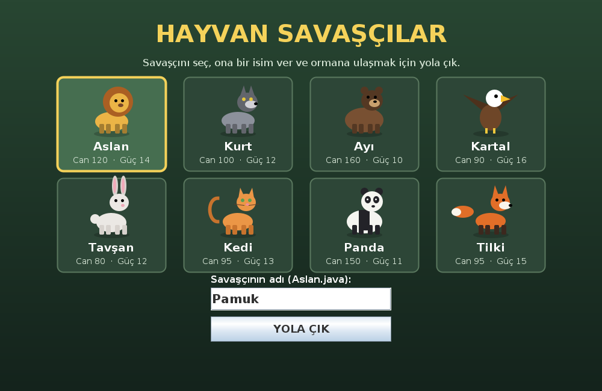
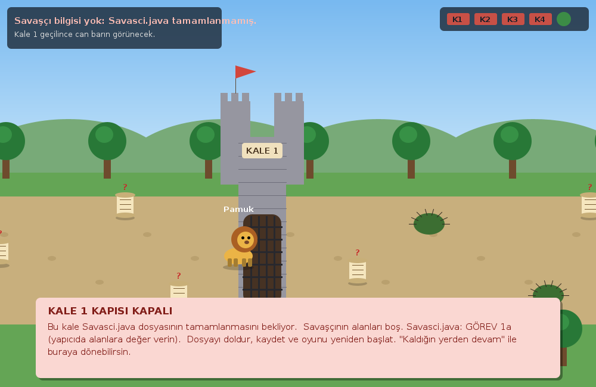
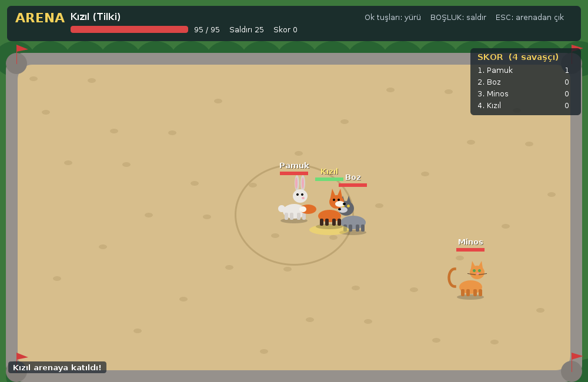

# Hayvan Savaşçılar

Sekiz hayvandan birini (Aslan, Kurt, Ayı, Kartal, Tavşan, Kedi, Panda, Tilki) savaşçın olarak seç, ona bir isim ver ve ormana ulaşmak için yola çık. Yolda dört kale var ve her kalenin kapısı bir Java sınıfının tamamlanmasını bekliyor. Sınıfları tamamladıkça savaşçın güçlenir; son kaleden sonra ormanın kapısını bekleyen Gölgeleri yenen kazanır.

| Savaşçını seç | Kapalı bir kale |
| --- | --- |
|  |  |

---

## Kurallar

- **Yapay zekâ araçları kullanılmaz.** Takılırsanız oyundaki ipucu kâğıtlarına, dosyalardaki açıklamalara, grup arkadaşlarınıza ya da öğretmeninize başvurun.
- Yalnızca `GÖREV` yazan yerleri doldurun.
- `Main.java`, `OyunPaneli.java`, `Esya.java`, `HayvanCizimi.java`, `ArenaIstemcisi.java` ve `ArenaSunucusu.java` dosyalarını değiştirmeyin.

---

## Nasıl çalıştırılır?

Proje yalnızca standart Java kullanır; ek kütüphane gerekmez. Java 8 ve üzeri sürümlerde çalışır.

**NetBeans**

1. **File → New Project → Java with Ant → Java Application** seçin. Proje adı verin, **Create Main Class** kutusunun işaretini kaldırın.
2. `src` klasöründeki bütün `.java` dosyalarını, NetBeans'te **Source Packages → &lt;default package&gt;** üzerine sürükleyin.
3. `Main.java` dosyasına sağ tıklayın → **Run File** (Shift + F6).

**Eclipse**

1. **File → New → Java Project** seçin. Proje adı verin. **Create module-info.java file** kutusunun işaretini **kaldırın** (işaretli kalırsa dosyalar derlenmez).
2. `src` klasöründeki bütün `.java` dosyalarını Eclipse'teki projenin `src` klasörüne sürükleyin, **Copy files** seçin.
3. `Main.java` dosyasına sağ tıklayın → **Run As → Java Application**.
4. Türkçe karakterler bozuk görünürse: **Window → Preferences → General → Workspace → Text file encoding → UTF-8**.

**IntelliJ IDEA / VS Code:** Klasörü açın, `src/Main.java` dosyasını çalıştırın.

**Terminal:**

```
cd src
javac -encoding UTF-8 *.java
java Main
```

**Oyun tuşları:** Ok tuşları (ya da W A S D) ile yürü. Kale 4'ten sonra **BOŞLUK** tuşuyla saldır.

Bir görevi bitirince dosyayı kaydedin ve oyunu **kapatıp yeniden açın**. Seçim ekranındaki **KALDIĞIN YERDEN DEVAM** düğmesi sizi en son geçtiğiniz kaleye götürür.

---

## Kaleler

| Kale | Dosya | Konu | Görevler | Açılınca |
| --- | --- | --- | --- | --- |
| 1 | `Savasci.java` | Üst sınıf, yapıcı | 1a, 1b | Can barın görünür, dikenler canını azaltır. |
| 2 | Seçtiğin hayvanın dosyası | `extends` ve `super(...)` | 2a, 2b | Seçtiğin hayvana dönüşürsün; can ve güç hayvanın değerleri olur. |
| 3 | `Iksir.java` | `extends`, `super(...)`, geçersiz kılma | 3a, 3b, 3c | Can İksirleri işe yarar. |
| 4 | Seçtiğin hayvanın dosyası | `super.tanit()`, `super.saldir()` | 4a, 4b | BOŞLUK ile saldırabilirsin. |

Kale 2 ve Kale 4 için **yalnızca seçtiğiniz hayvanın dosyasını** doldurmanız yeterli. Dosya adları Türkçe karakter içermez: `Aslan.java`, `Kurt.java`, `Ayi.java`, `Kartal.java`, `Tavsan.java`, `Kedi.java`, `Panda.java`, `Tilki.java`. Başka bir hayvanla oynamak isterseniz onun dosyasını da doldurmanız gerekir.

---

## Grupla çalışma

| Üye | Dosya |
| --- | --- |
| 1 | `Savasci.java` (Kale 1) |
| 2 | Seçilen hayvanın dosyası, görev 2a ve 2b (Kale 2) |
| 3 | `Iksir.java` (Kale 3) |
| 4 | Seçilen hayvanın dosyası, görev 4a ve 4b (Kale 4) |

Kale 4'ün görevleri, Kale 2'nin görevleri yapılmadan derlenmez. 2. ve 4. üye birlikte çalışabilir.

---

## Dikkat edilecekler

- `extends` ekleyip `super(...)` satırını yazmazsanız program **derlenmez**. Bu iki görevi birlikte yapın.
- `super(...)` satırı yapıcının **ilk satırı** olmalıdır.
- Kale kapısının önünde durunca neyin eksik olduğu ekranda yazar.
- Yoldaki **?** işaretli kâğıtların üzerinden geçerek ipuçlarını okuyun.

---

## Arena

Ormana ulaşan savaşçılar arenada buluşup birbiriyle savaşır.



1. **KAZANDIN!** ekranında, öğretmeninizin tahtaya yazdığı arena adresini (örneğin `192.168.1.20`) kutuya yazın.
2. **ARENAYA KATIL** düğmesine basın.
3. Ok tuşlarıyla yürüyün, **BOŞLUK** ile yakındaki rakibe saldırın. Saldırı gücünüz, hayvanınızın `saldir()` metodundan gelir.
4. Bir rakibi yenince skorunuz 1 artar. Yenilen savaşçı arenada başka bir yerde, kısa bir koruma kalkanıyla yeniden doğar.
5. **ESC** ile arenadan çıkarsınız.

Oyunu daha önce bitirdiyseniz yolu yeniden yürümeniz gerekmez: seçim ekranındaki **ARENAYA GİT** düğmesi sizi doğrudan arena ekranına götürür. Bunun için kodunuzdaki bütün görevlerin hâlâ tamam olması gerekir.

Arenaya bağlanmak için öğretmeninizin bilgisayarıyla **aynı ağda** olmanız gerekir.
